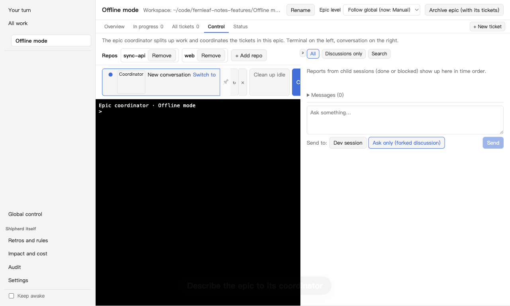

# Butler

**Talk to one coordinator. It runs your Claude Code sessions and only pings you when it's your turn.**



**Download:** [macOS (Apple silicon)](https://github.com/yul761/butler/releases/latest) · [Windows](https://github.com/yul761/butler/releases/latest) · MIT · [butler.statecore.io](https://butler.statecore.io) · **English** | [简体中文](README.zh-CN.md)

- **Hand over a body of work, not a prompt.** Describe an epic to its coordinator. It splits the work into tickets and gives each ticket its own session and git worktree. The PRs land in order, and a merge that would collide with another ticket's branch is held back until that one has landed.
- **Answer in one place.** Whenever a session needs you, a card shows up on the **Your turn** page: a question, a permission prompt, a PR ready to merge. A session that has stopped moving gets a card too, with its likely cause.
- **Sessions share memory.** A convention one session settles, such as an API contract, reaches every other session in the epic. A long session is handed off, cleared and picks up from memory where it left off.

**Local-first.** Butler itself calls no model and sends no telemetry. Your data leaves your machine only through your own `claude` and `gh`. Even the once-a-day update check goes through `gh` and only tells you; it never downloads or installs anything.

## Quick start

1. Download Butler, install it and open it (the first launch needs one extra click, see [Install](#install)). The **Welcome to Butler** wizard checks Claude Code and installs Butler's hooks.
2. On the **All work** page, click **+ New epic**, give it a name and pick its repos.
3. On the epic's **Control** tab, open a **Coordinator session** and describe the work. The coordinator creates the tickets and starts a session in each one. You answer on **Your turn** and click to merge.

[How it works](docs/how-it-works.md) · [Compared with running sessions side by side](docs/compare.md) · [Configuration](docs/configuration.md)

## Requirements

- macOS on Apple silicon, or Windows 10/11 x64. Intel Macs can [build from source](CONTRIBUTING.md).
- Claude Code installed and logged in: `claude --version` must work in a terminal.
- Git on `PATH`. On Windows, install **Git for Windows**: Claude Code runs hooks through Git Bash, and Butler won't run git if it can't find `git.exe`.

## Install

Download the latest release from the [Releases page](https://github.com/yul761/butler/releases/latest):

- macOS: `Butler-x.y.z-arm64.dmg` (or `Butler-x.y.z-arm64-mac.zip`), about 170 MB
- Windows: `Butler-Setup-x.y.z.exe`, about 140 MB

The builds are not code-signed yet (see [Code signing](docs/how-it-works.md#code-signing)), so the first launch needs one extra step.

### macOS (Gatekeeper)

1. Open the `.dmg` and drag Butler into Applications.
2. Open Butler. macOS refuses: it says Apple cannot verify the app.
3. Open **System Settings → Privacy & Security**, scroll down to the message about Butler, click **Open Anyway** and confirm. Or, in a terminal:

   ```sh
   xattr -dr com.apple.quarantine /Applications/Butler.app
   ```

If macOS says Butler "is damaged and can't be opened", there is no **Open Anyway** button: use the `xattr` command. Repeat this after every new download.

### Windows (SmartScreen)

1. Run `Butler-Setup-x.y.z.exe`. If Edge warns about the download, choose **Keep** in the download's **…** menu.
2. SmartScreen says "Windows protected your PC". Click **More info → Run anyway**.
3. Pick "only for me" (no admin rights needed).

If Windows 11 **Smart App Control** is on, it blocks unsigned apps with no way around it, so Butler can't be installed while it is on.

To upgrade, download the new version and install it over the old one. Your data in `~/.butler` is kept. What changed in each version is in the [release notes](https://github.com/yul761/butler/releases).

## First run

The **Welcome to Butler** wizard has three steps:

1. **Check Claude Code.** Butler finds `claude` on your login shell's `PATH`, or you give it the absolute path.
2. **Install the hooks.** Butler merges four hooks and a `/handoff` command into your user-level Claude Code settings, keeps your own hooks and saves a backup first. The hooks only drop small JSON files into `~/.butler/inbox`; they never touch the network. **Settings → Environment check → Uninstall** removes them.
3. **Done.** The tracker MCP tools and the permission profile are optional and live in Settings.

Don't also install StateCore's own Claude Code capture plugin: Butler already gives its sessions StateCore memory, and with both, memory is recorded twice.

Every setting is described in [docs/configuration.md](docs/configuration.md), including how to adapt Butler to your tracker and conventions.

## Uninstall

1. **Settings → Environment check → Uninstall** removes Butler's hooks and `/handoff` command from Claude Code.
2. Delete the app: drag it out of Applications on macOS, or use Settings → Apps → Butler → Uninstall on Windows.
3. To remove your data too, delete `~/.butler` and Electron's profile folder (`~/Library/Application Support/butler` on macOS, `%APPDATA%\butler` on Windows).

## Development

See [CONTRIBUTING.md](CONTRIBUTING.md).

## License

[MIT](LICENSE)
