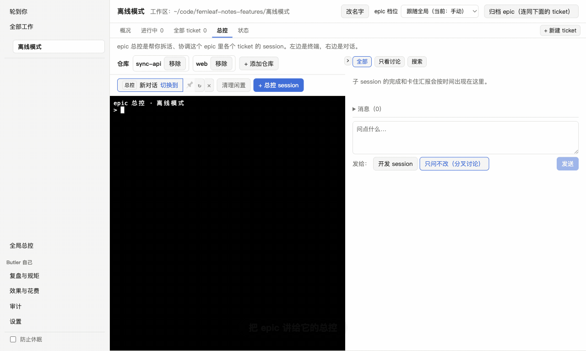

# Shipherd

**和一个总控对话。它替你管好各个 Claude Code session，只在轮到你的时候叫你。**

**下载：** [macOS（Apple silicon）](https://github.com/yul761/shipherd/releases/latest) · [Windows](https://github.com/yul761/shipherd/releases/latest) · MIT · [shipherd.statecore.io](https://shipherd.statecore.io) · [English](README.md) | **简体中文**

- **交出去的是一块活，不是一条提示词。** 把一个 epic 讲给它的总控听。总控把活拆成几个 ticket，每个 ticket 有自己的 session 和 git worktree。总控按顺序推进，每次合并之前 Shipherd 都会检查：两个分支冲突时，先合的先合，另一个 ticket 会被告知要 rebase。
- **在一个地方回答。** session 需要你的时候，**轮到你** 页上就会出现一张卡片：一个问题、一个权限确认、一个可以合并的 PR。停住不动的 session 也会有一张卡片，附上可能的原因。
- **session 共享记忆。** 一个 session 存进 epic 记忆的约定，比如 API 约定，会发给这个 epic 里其他正在跑的 session。上下文太长的 session 会先写交接、清空，再从记忆里接着做。

**本地优先。** Shipherd 自己没有模型，也没有 API key：后台的活都经你自己的 `claude` 做，也不发遥测。数据只会经你自己的 `claude`、`git` 和 `gh` 离开你的电脑，另外就是你自己设了的通知 webhook。连每天一次的更新检查也走 `gh`，只提示，不下载不安装。

## 快速开始

1. 装好 Claude Code 并登录一次：在终端里运行 `claude`。然后下载、安装并打开 Shipherd（第一次打开要多点一下，见[安装](#安装)）。向导 **欢迎使用 Shipherd** 会检查 Claude Code、装好 Shipherd 的 hook。
2. 在 **全部工作** 页点 **+ 新建 epic**，起个名字，选好仓库。
3. 在 epic 的 **总控** tab 里点 **+ 总控 session**，把要做的活讲给它听。总控会建好 ticket，在每个 ticket 里开 session。你在 **轮到你** 页回答问题，把它说可以合的 PR 合进去。

[Shipherd 是怎么工作的](docs/how-it-works.zh-CN.md) · [和并排开几个 session 有什么不同](docs/compare.zh-CN.md) · [配置说明](docs/configuration.zh-CN.md)

## 系统要求

- Apple silicon 的 macOS，或 Windows 10/11 x64。Intel Mac 可以[从源码构建](CONTRIBUTING.zh-CN.md)。
- 已安装并登录 Claude Code：终端里 `claude --version` 要能运行。
- 可选：GitHub CLI（`gh`），并用 `gh auth login` 登录。不装 session 照样能用，只是 PR、CI、review 相关的功能不工作。
- 可选：在 Claude Code 里配置好一个 tracker MCP server（Jira、Linear、GitLab……），handoff 就能读到 ticket 状态。
- `PATH` 上有 Git。Windows 上请安装 **Git for Windows**：Claude Code 通过 Git Bash 运行 hook，Shipherd 找不到 `git.exe` 时不会运行 git。

## 安装

从 [Releases 页面](https://github.com/yul761/shipherd/releases/latest)下载最新版本：

- macOS：`Shipherd-x.y.z-arm64.dmg`（或 `Shipherd-x.y.z-arm64-mac.zip`），约 170 MB
- Windows：`Shipherd-Setup-x.y.z.exe`，约 140 MB

装好以后 macOS 版约占 455 MB，其中约 140 MB 是 `shipherd-hook`，也就是 Claude Code 每次触发 hook 时运行的程序；安装 hook 时会把它复制到 `~/.shipherd/bin`。

在 macOS 上，打开 `.dmg`，把 Shipherd 拖进"应用程序"。macOS 版用 Developer ID 签名并通过 Apple 公证，双击即可打开。

Windows 安装包还没有代码签名（见[代码签名](docs/how-it-works.zh-CN.md#代码签名)），所以第一次打开要多做一步。

### Windows（SmartScreen）

1. 运行 `Shipherd-Setup-x.y.z.exe`。如果 Edge 警告这个下载，在下载项的 **…** 菜单里选 **保留**。
2. SmartScreen 提示"Windows 已保护你的电脑"。点 **更多信息 → 仍要运行**。
3. 选"仅为我安装"（不需要管理员权限）。

如果开着 Windows 11 的**智能应用控制**，它会拦下未签名的 app，而且没法放行，开着它时装不了 Shipherd。关掉它之前请先看 Microsoft 的说明。

升级时下载新版本，直接覆盖安装。你在 `~/.shipherd` 里的数据会保留。每个版本改了什么见 [release notes](https://github.com/yul761/shipherd/releases)。

### 从 Butler 升级

<!-- Butler 是 Shipherd 改名前的名字，这一节写给从它升级的人。 -->
Shipherd 以前叫 Butler。退出 Butler，装上 Shipherd；第一次打开之前，把正在运行的 `claude` 也都退出（Shipherd 第一次启动时会改 Claude Code 的设置和 `~/.claude.json`，正在运行的 `claude` 可能把改动覆盖掉）。什么都不会丢：

- 第一次启动时，Shipherd 把 `~/.butler` 搬到 `~/.shipherd`，旧位置留一个指向新目录的链接（Windows 上是目录联接；建不了链接就留一个说明文件）。数据库、记忆、日志和设置都跟着过来；worktree 在 `~/.butler` 下的 session，它们的 Claude Code 对话记录也一起搬。如果你设过 `BUTLER_HOME`，在你设 `SHIPHERD_HOME` 之前它仍然有效。
- `~/.claude/settings.json` 里 Butler 的 hook 换成 Shipherd 的（你自己的 hook 不动），`/handoff` 命令也会更新。升级时正在跑的 session 照常上报。
- 从 Butler 导出的文件（配置、备份）可以直接导入。
- Butler 还开着时，Shipherd 会提示你先退出它，然后自己退出：两个不能同时运行。
- **macOS：**把 Butler 从"应用程序"里拖出去。macOS 把 Shipherd 当成一个新 app，你给过 Butler 的权限（通知等）要重新授予一次。保存过的通知 webhook 地址换名后读不出来，设置里会提示你重新填写。
- **Windows：**Shipherd 装在 Butler 旁边，不会覆盖它。安装程序检测到 Butler 时会提示你卸载；当时跳过的话，之后在 设置 → 应用 → Butler → 卸载。卸载 Butler 不会删你的数据。

## 首次运行

打开 Shipherd 之前，先装好 Claude Code 并登录一次：在终端里运行 `claude`，按提示登录。GitHub CLI（`gh`）可装可不装，见[系统要求](#系统要求)。

向导 **欢迎使用 Shipherd** 只有两步：

1. **检查 Claude Code。** Shipherd 在你登录 shell 的 `PATH` 上找 `claude`，找不到再看常见的安装位置（`~/.local/bin`、`~/.claude/local`；Windows 上 `%USERPROFILE%\.local\bin` 和 `%APPDATA%\npm`），或者由你给出绝对路径。它还会检查 `claude --help` 是否列出了 Shipherd 依赖的参数，没有能用的 `claude` 就无法继续。`claude` 看起来还没登录时会提示你，也会写出 `gh` 装了没有、登录了没有，这两样都不拦下一步。
2. **安装 hook 和 /handoff 命令。** 点 **安装并继续**。Shipherd 把四个 hook 和一个 `/handoff` 命令合并进你用户级的 Claude Code 设置，保留你自己的 hook，并先做一份备份。没有它们，**轮到你** 和状态都不工作。这些 hook 只往 Shipherd 数据目录（默认 `~/.shipherd`，设了 `SHIPHERD_HOME` 就是那里）的 `inbox` 里放小 JSON 文件，从不访问网络，退出码永远是 0。用 **设置 → 健康检查 → 卸载** 可以移除。

然后是 **准备好了**，点 **开始使用** 进入首页。可以像[快速开始](#快速开始)那样从一个 epic 开始，也可以只开一个 ticket：新建 ticket，给它添加一个仓库（Claude 在那里干活），在它的概况上点 **开第一个 session**。session 停下来等你时，**轮到你** 里会出现它。

有两样不在向导里，之后在设置页配：tracker（Jira、Linear、GitLab……）的只读 MCP 工具在 **设置 → 高级 → 定时与状态**；[权限档案](docs/configuration.zh-CN.md#权限档案) 在 **设置 → 高级 → 打断与通知**。向导可以在 **设置 → 基本** 里重新运行。

不要再另外安装 StateCore 自己的 Claude Code 采集插件：Shipherd 已经给它开的 session 配好了 StateCore 记忆，两个都装会把记忆记两遍。

每一项设置都写在 [docs/configuration.zh-CN.md](docs/configuration.zh-CN.md) 里，包括怎么让 Shipherd 适配你的 tracker 和习惯。

## 卸载

1. **设置 → 健康检查 → 卸载** 会从 Claude Code 里移除 Shipherd 的 hook 和 `/handoff` 命令。
2. 删除 app：macOS 上把它从"应用程序"里拖出去；Windows 上在 设置 → 应用 → Shipherd → 卸载。
3. 如果也要删除数据，删掉 `~/.shipherd` 和 Electron 的配置文件夹（macOS 上是 `~/Library/Application Support/shipherd`，Windows 上是 `%APPDATA%\shipherd`）。在 macOS 上，如果你保存过 webhook 地址，还要在"钥匙串访问"里删掉"shipherd Safe Storage"这一项。从 Butler 升级的，Electron 配置文件夹还是旧名字 `butler`，`~/.butler` 那个链接或说明文件也可以删掉。

## 反馈

发现 bug 或有想法？**帮助 → 发送反馈…**（或者 **设置 → 关于** 里的按钮）会在浏览器里打开填好的 GitHub issue，由你自己提交，Shipherd 自己不往外发任何东西。诊断可选，脱敏后先给你看，再存进「下载」文件夹，由你拖进 issue。有问题可以去 [Discussions](https://github.com/yul761/shipherd/discussions) 问。

## 开发

见 [CONTRIBUTING.zh-CN.md](CONTRIBUTING.zh-CN.md)。

## 许可证

[MIT](LICENSE)
