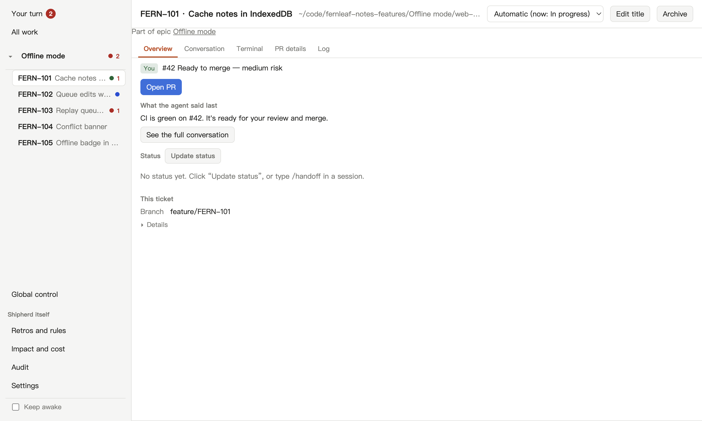
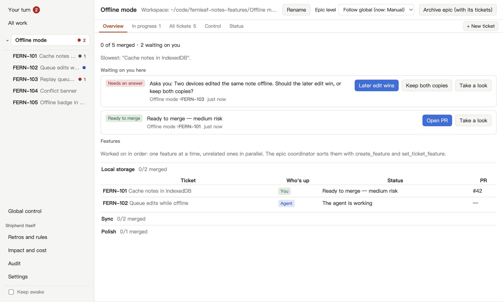
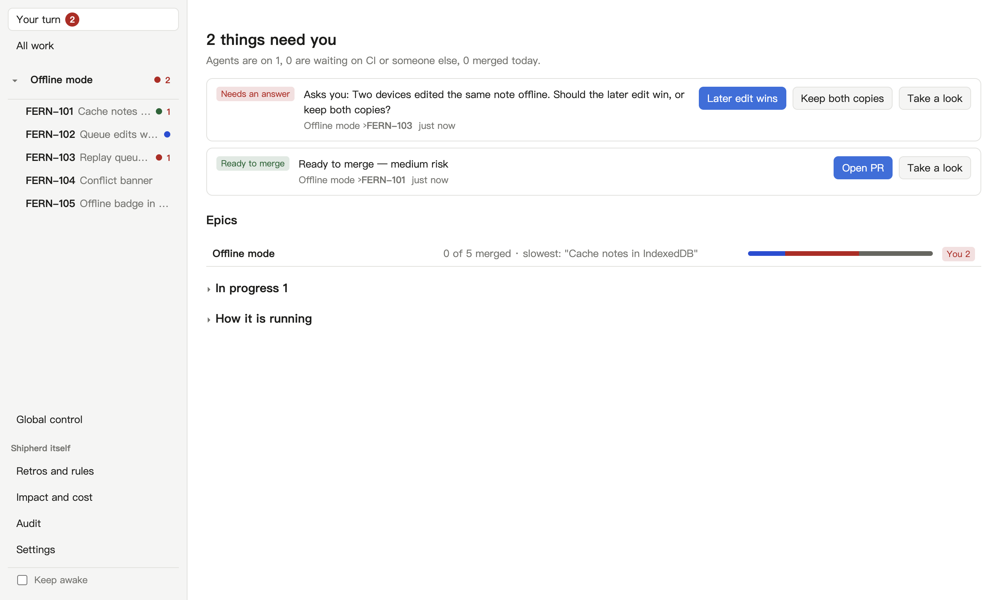

# How Butler works

**English** | [简体中文](how-it-works.zh-CN.md)

Tickets can be grouped into epics. An epic is one body of work, such as one Jira epic: it has one workspace, one coordinator session and one shared memory, and inside it the tickets can be sorted into features that are worked on in order. Talk the work through with the epic coordinator and it creates the tickets, sorts them into features, opens a session in each ticket and hands it its task. Sessions don't talk to each other directly. They share layered memory in a local StateCore store, so the progress and decisions one session saves can be read by the others in the same ticket or epic. The **Your turn** page puts what needs you first, and **All work** lists every epic and ticket with what each session is doing. When a session needs a decision from you it says so with `ask_user`, and it reports progress with `report`; both land in tabs on the epic and **Global control** pages. Each night Butler writes a handoff for every ticket that moved.

## Tickets and sessions

Each ticket has its worktree or branch, its Claude Code sessions (embedded terminals), its PR state and its after-merge follow-ups. Turn on **Settings → Basics → Show sessions started outside Butler** (`showOutsideSessions`, off by default) and the sessions you started outside Butler in the last 7 days show up under **All work → Unclaimed sessions**, so you can attach them to a ticket. While it is off, Butler doesn't scan `~/.claude/projects` to find them. A ticket can span several repos (say, a frontend and a backend): create it with or without a repo, then add more on the ticket page. Each repo has its own work mode and branch, and **Edit** changes them later. A new session asks which repo to work in. A running session, including one a coordinator started, has an × next to its button: click it twice to end that session. Its conversation is kept, and clicking the button opens it again. A session that is not running can be hidden with the same ×. It only leaves the list (its conversation is kept), and **Hidden** brings it back. Sessions that Butler opens do not stop at Claude Code's question about which servers from a repo's `.mcp.json` to enable: Butler enables them, except the ones you turned off in that repo before. All sessions of a ticket share its memory. A ticket has no coordinator of its own: its sessions work side by side, and in an epic the epic coordinator (see [Epics](#epics)) opens and manages them. Every ticket session gets a `butler-sessions` MCP server with `ask_user` and `report` (see [Questions and reports](#questions-and-reports)), plus `submit_evidence` and `pre_review_result` for [pre-review](configuration.md#pre-review-readiness-and-risk).

New ticket branches start from the remote's default branch: Butler fetches origin first and branches off `origin/<default>` (`origin/HEAD`, or `main` / `master`), whatever your checkout is on, without touching it. Offline it uses what it fetched last, and a repo without a remote branches off its local `main`. A ticket stacked on another with `stack_on` still branches off the ticket below it.

Before Butler hands a new session its first task, it looks at the real terminal screen, so it never presses Enter on a trust dialog or a permission prompt. It then checks that the task was submitted.

There are deliberate limits:
- **Communication:** a coordinator never types into other sessions directly. It talks to them through their mailboxes (see [Mailbox](#mailbox)), and sessions also share the ticket and epic memory.
- **How many sessions run at once:** as many as memory allows. Before opening a session Butler checks that available memory minus what a new session needs stays above a reserve you set in Settings (see [Parallel sessions](configuration.md#parallel-sessions)); there is no fixed number per ticket or epic. Archived tickets are listed under **Archived**, where you can restore them. In the terminal on Windows, Ctrl+V and right-click paste, and Ctrl+C copies when text is selected.

## Mailbox

Every session Butler opens has a mailbox. Whatever Butler or another session sends it goes there: a coordinator's message, a report or `ask_user` answer, a pre-review result, a PR comment, a CI result, a merge notice, a stack conflict, the daily patrol, a spend notice, the "carry on" after a refresh, what you send from the conversation tab, a reply. Messages are queued in Butler's database, so a restart doesn't lose them, and nothing is ever refused because the target is busy. A session that is working gets its messages at its next tool call, through a `PostToolUse` hook in its own per-session settings, with several merged into one. A closed session is resumed first (see [Session lifecycle](#session-lifecycle)). A stopped session gets them typed in, the same safe way as a first task: Butler looks at the screen first, waits while you are typing, and checks afterwards that they were submitted. A coordinator's message can ask to interrupt: Butler presses Esc first, then types it in. While a session's mailbox is empty, the hook is a single shell test that doesn't start Butler's hook program (about 2 ms instead of about 28 ms on an Apple-silicon Mac). When a session in an epic saves something to the epic memory, the other running sessions of that epic get it as a **convention**; the session that wrote it doesn't. Each message is **Queued**, **Delivered** (between tool calls, or typed in) or **Replied**. The **Messages (N)** list on the **Global control** page and on an epic's **Control** tab shows the latest ones.

## Epics

An epic has a name and groups tickets, say two frontend and two backend tickets, each with its own Jira id and branch. Create it with **+ New epic**. When asked for a repo you can pick the folder that holds your repos, such as `~/Code/shop` with `frontend/` and `backend/` inside. Butler lists the repos one level down and you tick the ones you want. Picking a parent folder works the same way when you create a ticket or add a repo. Every ticket in an epic gets its worktrees inside the epic's workspace, `<parent>-features/<epic name>` next to the parent folder by default, for example `~/Code/shop-features/checkout/frontend-dms-1234`. That way several tickets in one repo can be worked on at the same time. An epic has one **epic coordinator** session. It runs in the workspace and sees every ticket's worktree. Its `butler-sessions` server offers:

- `list_tickets`, which lists the epic's tickets, their repos and the feature each one is in;
- `list_repos`, which lists the epic's repos;
- `create_ticket`, which creates a ticket in the epic (its id, an optional title, the repos it uses, an optional branch, and optionally the feature to put it in or another ticket to stack it on with `stack_on`), with its worktrees in the workspace. The ticket shows up in Butler right away. So you can talk the epic through with the coordinator, let it create the tickets, and then let it start a session in each one;
- `start_session`, which opens a session in a ticket (naming the repo only when the ticket has several) and sends it a task as its first message. The new session appears under its ticket, where you can watch it, take over and answer its permission prompts;
- `list_sessions`, which shows the sessions of the coordinator and of every ticket, with what each is doing and the end of its last reply;
- `send_message`, which puts a message in the mailbox of one of the epic's ticket sessions or fix sessions, even while it is working. With `interrupt` Butler presses Esc first. Its last reply of that turn comes back to the coordinator;
- `session_activity`, which shows one session's activity plus its last command output (up to 4 KB);
- `end_session`, which closes a finished session of a ticket in the epic, or one of the epic's fix sessions, the same as clicking its ×. It refuses a session that is still working, one showing a prompt that waits for you, one that isn't running, and the coordinator itself. A hibernated session (Butler ended its process to save memory; `list_sessions` marks it `hibernated`) still counts toward the session limit, and `end_session` on it stops Butler from waking it and frees its place;
- `refresh_session`, which gives one of those sessions a fresh context once it has stopped (see **Refresh keeps the conversation** under [Session lifecycle](#session-lifecycle));
- the [feature tools](#features-inside-an-epic), the [stack](configuration.md#stacks) tools, and `ask_user` and `report`.

All its sessions also share the epic's memory, `butler-feature`, for things like the API contract between frontend and backend. A `claude` you open yourself in the workspace folder counts as the epic's coordinator. Archiving an epic archives its tickets too; Butler refuses while a terminal of the epic or its tickets is running. Restoring it brings back the tickets archived with it.

### Features inside an epic

A feature is a light block: a name, an optional description, a place in the epic's order and a set of tickets. It has no coordinator, no workspace and no memory of its own. The epic coordinator manages them:

- `list_features` lists them in order, each with its tickets, their status and how many are merged, plus the tickets that are in no feature yet;
- `create_feature` creates one (a name unique in the epic, an optional description of up to 2,000 characters, and optionally `before`, the feature to put it in front of; otherwise it goes last);
- `reorder_features` sets a new order, which must name every feature exactly once;
- `set_ticket_feature` moves an existing ticket into a feature, or out of all of them with `null`. Tickets imported from Jira are sorted into features this way.

The coordinator is told to push the features forward in order, one at a time, running features that don't depend on each other at the same time. A ticket is in at most one feature. There is no button for creating, renaming or reordering features: ask the coordinator, and the epic page shows the result. `reorder_features` and `set_ticket_feature` only change how Butler groups the tickets, so they don't ask for permission; `create_feature` does.

### The epic page

The epic page has five tabs: **Overview**, **In progress**, **All tickets**, **Control** and **Status**. One shows at a time, none of them collapses, and the page remembers which tab it was last on. **Overview** starts with a line of progress (how many tickets are merged and how many things wait on you) and the slowest ticket, then the cards under **Waiting on you here**. Below them, once the epic has features, the **Features** section has one collapsible row per feature, in order, with how many of its tickets are merged; expanding a row shows its tickets with the same columns as **All tickets**, and the first feature not fully merged starts expanded. Tickets in no feature are in a last row, **Not in a feature**. An epic without features shows one row per ticket instead, with how many of its PRs are merged (or **No PR yet**) and a bar coloured by whose turn each PR is. The **Overview** label turns red while a card is waiting there. **In progress** lists what is moving without you right now: an agent at work, or a wait on CI, a reviewer, the merge queue or the PR below in a stack, with who and how long it has been that way. **All tickets** is the table described below, grouped by feature in the same order. **Control** has the repos, the coordinator sessions and the terminal on the left and the conversation on the right: your exchange with the coordinator, with its sessions' reports mixed in by time. **Status** has the summary across the epic's tickets, with what is in the way and what comes next, and the epic's **Plan** when it has one. The summary is written by the nightly run for epics with new activity, by `/handoff` in the coordinator, or when you click **Update now**. It never shows a completion percentage.

**All tickets** has one row per ticket: who's up (you, the agent, or someone outside such as CI or a reviewer by name), the **Status** sentence for that turn (such as "The agent is fixing CI" or "Waiting for review from …") and its PRs. Each row shows the ticket's turn (see [PR progress](#pr-progress)), followed by "· N more PRs" when the ticket has other open PRs. When the epic has features, a header row per feature gives its name and how many of its tickets are merged. Click a row to open the ticket.

In the sidebar, each epic is a row that collapses, with its tickets under it, above the tickets that are in no epic. Each ticket and epic there has a dot coloured by whose turn it is and the number of things waiting on you; they add up from ticket to epic and stay visible when the epic is collapsed.

### Stuck sessions

There is no fixed time limit, so a slow pre-push hook that is still working is left alone. Every 3 minutes Butler looks at each running session it opened, coordinators and standalone tickets included. If the transcript, the command output and the CPU use of the session's child processes have not changed for two checks in a row, Butler asks your own `claude` once, with no tools, whether the session is really stuck. It sends the current activity, the last command output and the end of the terminal. If the answer is yes, a **Stuck** card shows up on the **Your turn** page and under **Waiting on you here** on its epic, and the ticket or epic gets the stuck dot in the sidebar. There is no system notification. The card says what looks wrong and, when there is one, a suggested next step, with these buttons:

- **Take a look** opens the ticket page on the stuck session's terminal.
- **Open a fix session** opens a new session in the epic's workspace and hands it the details. The stuck session is left running, and the two share its worktree, so the new session's task says to tell the stuck session before changing a branch or stopping a process, to ask you before killing anything, and to tell the coordinator when the problem is solved.
- **It's fine, ignore** removes the card. It comes back only if the session moves again and then gets stuck again. It is only offered when the session was judged stuck for being silent, since that is the case that can be wrong (a very long test run, say).

The card also goes away by itself when the session has new activity. Nothing is fixed without your click, and stuck marks live in memory, so Butler checks afresh after a restart. Fix sessions, lesson-analysis runs and sessions of archived tickets or epics are not checked.

### From Jira

With [automatic intake](configuration.md#automatic-intake) pulling from your tracker, each ticket's parent epic decides where it goes. A ticket in a Jira epic goes into the Butler epic for that Jira epic; if there is none (or only an archived one), Butler creates one named after the Jira epic's key and title. The epic coordinator then sorts the new tickets into features. Tickets with no Jira epic stay standalone.

### Upgrading from the old epic layer

Earlier versions had a separate epic layer above features, with a planning session of its own, and each ticket could have its own coordinator. Both are gone. On the first start after the upgrade:

- each old feature becomes an epic of its own, with its workspace, worktrees, coordinator and memory where they were;
- an old epic's plan is added to the **Plan** of each of its former features, and the notes its planning session saved in memory are copied into each one's epic memory, under **Earlier conventions** (see [StateCore memory](#statecore-memory));
- the old epics are archived and their workspaces are left on disk;
- the old epics' planning sessions and the coordinators that tickets had of their own are hidden; they stay under **Hidden**, and such a coordinator reopened from there resumes as an ordinary ticket session;
- pending reports from those sessions, and from these epics' coordinators (formerly feature coordinators) to an old epic's planning session, are dismissed; reports from ticket sessions still go to their epic coordinator. Pending questions from a planning session are dismissed too, since no terminal can take the answer; a ticket coordinator's questions stay for you to answer.

## Questions and reports

Every session Butler opens has two tools, `ask_user` and `report`, so you no longer have to scroll a terminal for the question that is waiting for you.

- `ask_user` records one thing you have to decide, with optional options and background, and ends the session's turn.
- `report` hands progress to the coordinator above the session and to you. Its kind is `progress`, `done`, `blocked` or `choice` (a choice the session made for you because one option was clearly the one to recommend). A `done` or `blocked` report from a ticket session or fix session in an epic goes into the mailbox of the epic coordinator (see [Mailbox](#mailbox)). Reports from a standalone ticket, from an epic coordinator and from the global control are only stored, and the session is told that no coordinator manages it; the global control sees them with `list_inbox`. `progress` and `choice` reports are only stored.
- On the right side of an epic's **Control** tab, the reports from its sessions show up in the conversation with the coordinator, in time order, with who and when (with no coordinator session yet, only the reports are listed); the **Global control** page does the same with the latest 30 reports from everywhere. A pending `ask_user` question is a card on the **Your turn** page and under **Waiting on you here** on its epic. The card shows the question, up to two of its options as buttons and **Take a look**, which opens the session's terminal. On the ticket's **Overview** tab, a question from a running session is the ticket's turn and takes the top line, with one button, **Go answer**, that switches to the **Terminal** tab. Any other question (a later one from the same session, or one from a session that has since ended) gets its own row below, with up to two options as buttons and **Take a look**, which switches to the **Terminal** tab but doesn't pick the session that asked. There is no answer box: a third option onward, or an answer in your own words, goes in the terminal.
- An answer from a button goes into the session's mailbox as "you asked …, the user's answer: …": a working session gets it at its next tool call, a stopped one has it typed in. Right after you click, the card or row says it is on its way. On a question row of the ticket's **Overview** this stays while you switch tabs; if you leave the ticket and come back before it is delivered, the question shows again, and answering it again replaces your earlier answer. If you answer in the terminal first, the card goes away by itself.
- From a session, only what is really yours to decide gets a card: a permission, question or plan confirmation on the screen, a pending `ask_user`, a session that is really stuck, and a reply that asks for a decision. A reply such as "Shall I continue?" or "Anything else?" doesn't count, and a coordinator isn't listed again for what its child sessions already asked. PRs get cards too (**Ready to merge**, **Review requested**, and **Nobody on it**, say when CI failed and no session is fixing it), and so do the Butler notices that need you (**Butler needs a click**, see [Your turn page](#your-turn-page)). The number next to **Your turn** in the sidebar counts all of these cards.
- For these two tools the settings file Butler writes for the session allows them, so they don't ask for permission on first use. The other tools of the same server still do.

## Your turn page

The **Your turn** page is the first entry in the sidebar, and the entry shows how many things wait for you. Each thing that needs you gets a card at the top: a session waiting on a confirmation, a pending question, a reply that asks for your decision or really stuck, a PR ready to merge, a review requested from you, a PR nobody is on, and Butler notices that need you (a paused cost cap with **Continue and raise the cap**, a Claude limit, CI results with no session to take them for 30 minutes, review comments waiting for classification, a stack conflict, an auto-intake item that needs a decision). Below them, a collapsed **In progress** list shows every session that is running, with what each one is doing, its PR and CI, and how long it has been at it; click a row to open its terminal. At the bottom, the collapsed **How it is running** section holds **Other notes from Butler** (notices that only tell you something), the memory card, recent merges, the automatic intake log for the last 24 hours, the usage line and **Live**. **Live** shows the sessions that are working as small terminal cards around a Butler card: each card has its ticket, repo, a status pill and the last 3 tool calls, and a dot runs along a dashed line when a session writes to memory (blue, toward Butler) or reads from it (green, back to the session). A card waiting for you turns yellow and says **Needs you**. At most 8 cards are drawn. When nobody is working it says so. The working count on the page and in the groups counts only sessions that are really working (thinking, running a tool or a background command); a stopped session with a PR open is counted as idle. The animation respects your system's reduced-motion setting, and pauses while the window is in the background or **Live** is scrolled out of view. In the same section, one line shows the last 7 days of token usage: the total, the share of cache reads, and the share of turns with 200k or more tokens of context. It counts the sessions Butler opened, their subagents, and the `claude` runs Butler starts in the background (handoffs, epic summaries, stuck checks), read from Claude Code's transcripts on your machine. Click the line for the split by kind (**ticket sessions**, **coordinators**, **subagents**, **background jobs**) and by model. The shares are weighted by relative price, for comparing only; Butler doesn't convert them to money.

## PR progress

Each ticket has one turn: the most urgent of its open PRs' turns and its session's turn, which is yours, an agent's or someone else's, by name. While a PR is open, a session that has stopped or is idle doesn't count, so the ticket follows the PR, but a question from the session still comes first. The turn shows on the **Your turn** page and in the **Overview**, **In progress** and **All tickets** tabs of an epic. Where the ticket is a row (**In progress**, **All tickets**, the **All work** table and the top line of the ticket's own **Overview**), "· N more PRs" follows when the ticket has other open PRs; the cards don't show it. The ticket's **PR details** tab has the rest, PR by PR: the stages (see [PR stages](#pr-stages)), CI, review, risk and readiness, and unresolved comments. Stacked PRs per repo, the intake queue and the PRs waiting for your review are in the **Stacks, auto-intake and review queue** fold at the bottom of the **All work** page.

### PR stages

The stages are in the **Stages** section at the top of a ticket's **PR details** tab, collapsed until you open it (remembered per ticket on this computer); the ticket's **Overview** tab only says how many stages of its newest PR are done, inside its collapsed **Details** together with the context size. For every repo of the ticket it shows six steps: design, development, self-review, CI, peer review and merge. Done steps are green, the current one is blue, failed or sent-back ones are red, and steps not reached yet are grey. Butler works each step out by itself: design starts when a session of the ticket calls a design skill (such as brainstorming or writing-plans) and ends with the first commit on the branch, and shows **Skipped** if no skill was called (a design done earlier in the epic's coordinator counts as done); development starts with that first commit; self-review starts when a session calls a review skill (such as code-review or simplify) and ends at the next push or when the PR opens, and shows **Skipped** if none was called; CI starts once the PR is open, and a failed run sends the PR back to development; peer review starts when CI passes and ends when a person (not the PR author, not a bot, and not Copilot) approves, and a person asking for changes sends it back to development and counts the next round as round 2, while merging without any approval shows **Skipped**; merge ends when the PR is merged, and a PR closed without merging is marked **Closed**. Butler reads the PR's review list rather than `reviewDecision`, so repos that do not require reviews work too. If the hook program is out of date, design and self-review show **Unknown**, not **Skipped**. Sessions started before this version, and older tickets, may show design and self-review as **Skipped** even if a design or review was done, because those sessions were not recorded: skill tracking only starts with sessions launched after the upgrade (the Skill hook is added to a session's settings when it starts). A person's approval that is later dismissed no longer counts as peer review. Under the steps is a timeline: skill calls, the first commit, CI results, Copilot and peer review comments, and the `report`s the ticket's sessions send, such as the one-line summary after self-review. A **Hide timeline** toggle collapses it, remembered per row on this computer.

## Global control

One global session above all the epics, opened from **Global control** in the sidebar. Its working directory is `~/.butler/workspaces/_butler`, and it uses the workspace memory. Only one runs at a time: if one is open, the button switches to it, and to use another conversation you first quit it in the terminal. Its page, **Global control**, has no tabs: the session and its terminal are on the left, and the conversation is on the right, with the reports from every epic and ticket mixed in by time and the folded **Messages (N)** below.

- **It can see** all epics, the features inside them and every ticket, every PR with its review and CI state, every open session with what it is doing and whether it needs you, and the pending questions and recent reports (`list_epics`, `list_features`, `list_tickets`, `list_prs`, `list_sessions`, `session_activity`, `list_inbox`). `list_epics` gives each epic's status, Jira epic, coordinator session, summary and blockers, its features in order with how many of their tickets are merged, and whether the summary is stale. `list_prs` includes each PR's base and head branch, draft flag, reviewers asked and reviews given, mergeability and labels. `progress_overview` returns the whole progress overview in one call: the counts, whose turn each open PR is and for how long, PR stacks, the PR table and a one-line progress per epic. `metrics_overview` returns the **Impact and cost** page: cycle time, comments, interventions and cost per Butler PR against your own PRs from before Butler, why sessions stopped for you, and where the cost went.
- **It can act** only by talking: `send_message` passes a message to an epic coordinator, named by epic or by session id. Ticket sessions and fix sessions can't be messaged. If the coordinator's terminal is closed (closed for being idle, or since Butler restarted), Butler reopens its latest conversation, or a new coordinator if the epic never had one, and hands it the message. An open one gets it through its mailbox: at its next tool call if it is working, typed in once it has stopped and you aren't typing. With `interrupt` Butler presses Esc first. Each message gets a `requestId`; when the target finishes that turn, its last reply is typed back into the global control as a **[Reply]** block naming the `requestId`, and **Messages (N)** on its page lists the latest 30 messages, newest first, each **Queued**, **Delivered** or **Replied**. `refresh_epic_summary` writes a new epic summary in the background, the same as **Update now**. `refresh_session` clears a session's context. `ask_user` and `report` work as for any session; its own reports are only stored.
- **It can't** create, delete or end anything apart from [stacks](configuration.md#stacks), or open a session for any other reason. That stays with the epic coordinators.
- The read-only tools are allowed in the settings Butler writes for the session, so a patrol doesn't stop at a prompt on each one. `send_message`, `refresh_session` and `refresh_epic_summary` still ask.
- **Daily patrol.** Set **Daily global control patrol at** (`butlerPatrolTime`, off by default) and at that time Butler opens or reuses the global control and tells it to go over the PRs, CI and pending questions, to nudge the epic coordinators that need it, and to list with `ask_user` what you have to do yourself. If the global control is busy, the patrol goes into its mailbox and it reads it at its next tool call. A patrol missed because the computer was asleep or Butler closed runs once the same day after the next wake, unlock or launch. It opens a session at most once a day. See [Configuring Butler](configuration.md#schedule-and-status).
- While the global control is open it has its own live card under **How it is running** on the **Your turn** page. When it stops to wait for your answer it gets a card on that page: the patrol waits until it can take it.
- The global control is never refreshed or closed for being idle automatically.

## Merge coordinator

When two tickets in the same repo are about to collide, Butler steps in before the merge. It watches the sessions it opens, whichever epic or ticket they belong to, and checks only merges into a target branch and branch switches in a shared folder. It uses git to tell whether the branches conflict. First come, first served: the first merge goes ahead and the other ticket is told it will have to rebase; a merge that conflicts with one already under way waits until that one lands. Details are in [Configuring Butler](configuration.md#merge-coordinator).

## Session lifecycle

- **Ending finished sessions.** An epic coordinator can close a session that has stopped and waits for input, using `end_session`. It refuses a session that is working, one waiting for your answer, and itself.
- **Cleaning up sessions.** A terminal left open and idle takes hundreds of MB. After a session has been idle for `idleCloseMinutes` (180 by default, `0` turns it off, at least 10), Butler has it write a handoff and then ends its terminal. The session stays in the list and can be resumed. It is skipped while anything waits on you, a background task runs, it waits for a merge or CI result, or (for a coordinator) a child session is working. Time the computer was asleep doesn't count. A hidden session is deleted from Butler after 14 days; its conversation file stays. In the session bar, **Clean up idle** closes the sessions that have been idle for 5 minutes or more at once, and the **Hidden** list has **Delete all**. See [Configuring Butler](configuration.md#memory-statecore).
- **Closed sessions are resumed for messages.** When a coordinator messages a closed session it started (say, after a restart), Butler resumes it in the background after a memory check and delivers. Sessions you end with × stay ended. **Settings → Basics** can resume the sessions that were working when Butler last quit.
- **Refresh keeps the conversation.** When a session is refreshed (the ↻ button, a coordinator's `refresh_session`, or automatically when its context grows too long), Butler first has it write a handoff and waits until memory has stored it. It also saves the last few turns of the conversation to `~/.butler/refresh/<session>.md`, without calling a model. After `/clear` the session recalls the handoff, reads that file and carries on with what it was doing, or says what it is waiting for and keeps waiting. It no longer stops and waits for your next instruction.
- **Worktree cleanup after merge.** Once a handoff reports that a ticket's PR is merged, Butler removes that ticket's worktrees with `git worktree remove`. The branch is kept, and opening a session there again rebuilds the worktree. Butler does not remove a worktree that has uncommitted changes or untracked files, or one whose own session is still running in a terminal. In that case the ticket page shows why, with a **Check again** button, and Butler tries again when that terminal exits. Files ignored by `.gitignore` (`node_modules`, a local `.env`) are removed with the worktree.
- **Keep awake.** When sessions should keep running while you're away with the lid open, tick **Keep awake** at the bottom of the sidebar or in the tray menu. While it's on, the computer doesn't sleep when idle and the screen stays on. It turns off when you untick it, when the computer goes to sleep (closing the lid), and when Butler quits, and Butler always starts with it off. Closing the lid still puts a Mac to sleep; on Windows that depends on your lid setting.

## Retros and rules

Butler reads the review comments on your merged PRs (through `gh` and your own `claude`) and distils them into rules for each repo, such as "add a migration when you change the schema". Open **Retros and rules** in the sidebar to see them: the page shows only the **Pending** list, across all repos and products, with where each rule belongs, why and its source PRs. Each one waits until you confirm, edit-and-confirm or reject it, and a count in the sidebar shows how many wait. Everything else is in the collapsed **Advanced** section: the rules by repo and product, filters and bulk actions, batches and undo, the admission policy, products, import and export, the wizard, calibration, checks and backtests. Click **Analyze history** on a repo to go back over its past PRs; new merged PRs are picked up afterwards. Related repos can be grouped into a product, and a product's rules go to all its repos. Only confirmed rules are sent, and only to the ticket sessions and fix sessions Butler opens, as part of the session guide (at most 30 rules per session, most often seen first). A rule you change applies the next time a session is opened or resumed, not to sessions already running. Rules live only in Butler; nothing is written to your repo (no `CLAUDE.md`, no `.github/copilot-instructions.md`).

## Status and nightly handoffs

At a time you choose, Butler asks your own logged-in `claude` to write a structured handoff for every ticket that had activity. The latest one is the ticket's **Status**, at the top of its **Overview** tab: what got done, next steps, blockers and open questions, with an **Update status** button that writes a new one now. The **Log** tab keeps the **Status history**.

- `Edit`, `Write` and `NotebookEdit` are always denied.
- Butler allows file reads, `gh pr view`, `gh pr checks`, `git log`, `git status` and the tracker MCP tools you picked.
- Any other permission comes from your own Claude Code settings: the user-level allow rules (the runs use `--setting-sources user`) and any managed policy settings.
- These runs are not strictly read-only. If your settings allow, say, `Bash(npm:*)` or a write-capable MCP tool, the runs can use it too.

Inside a session you can also type `/handoff`. In an epic's coordinator, `/handoff` writes the epic's summary instead of a ticket handoff, and Butler then runs handoffs in the background for the epic's tickets that had activity since their last one.

## StateCore memory

Progress, decisions, open follow-ups and cross-ticket learnings go into a local [StateCore](https://github.com/yul761/StateCore) store. Every session Butler starts can `recall` them. The ticket page's **Log** tab has a **Memory** section that shows each entry's history.

Butler embeds StateCore. Each session Butler starts gets two keyless MCP servers. `butler-memory` holds this ticket's memory and `butler-workspace` holds learnings shared across tickets. Sessions of a ticket in an epic also get `butler-feature`, the epic's memory (scope `feature:<id>`), which the epic's coordinator gets together with `butler-workspace`. Features inside an epic have no memory of their own.

The epic's memory is where conventions shared across its tickets live, such as an API contract or a naming rule, and it holds about 60 of them. A session saves one with `remember`. Notes in the scope count toward StateCore's 30; when the scope reaches 26, Butler moves the oldest notes Claude wrote into the epic's archive, until 20 are left (it checks each time a session of the epic stops, and at start-up). StateCore keeps the moved notes on its audit trail, and the archive keeps the newest 40. The handoff Butler writes to the scope carries the epic's summary, then **Plan** (the epic's plan, when it has one), **Conventions** (the decisions in the epic's summary) and **Earlier conventions** (the archive), then the next steps and open questions. To change an earlier convention, remember the new version. A burst of more than 4 new notes between two stops can still push out the oldest ones. Ticket scopes are unchanged.

**Do not also install StateCore's own Claude Code capture plugin.** Butler already provides StateCore memory in the sessions it starts, and with both installed memory is recorded twice. Settings warns you if it finds the plugin.

- **No model, no network.** StateCore runs only on your machine and calls no model. The memory servers that Claude Code starts get no model API key: Butler strips model variables from their environment and turns StateCore's background digest off. Butler's own writes (handoffs, decisions, follow-ups, learnings) are deterministic and need no model.
- **Long entries stay word for word.** What Claude saves with `remember(consolidate: true)` (up to 2,000 characters) is kept as an event, exactly as written. Nothing distils it into facts; `recall` returns it among the recent events, next to the notes.
- **Memory holds 30 live notes per ticket.** StateCore keeps at most 30 notes per scope (one scope per ticket). Since statecore-mcp 1.1, finished follow-ups and replaced decisions free their slots. A ticket can still fill up if it has more than 30 open follow-ups and decisions at once (Butler keeps at most 24 of its own), or if Claude writes many notes itself. See [docs/configuration.md](configuration.md#how-memory-works).

## Language

The UI comes in English and Chinese. It follows your system language at first (Chinese for any Chinese locale, English otherwise); change it under **Settings → Basics → 语言 / Language** or on the first-run wizard. The language also switches the default prompts Butler sends to `claude`, so handoffs and memory notes are written in that language; prompts you edited yourself are kept. Installs upgraded from 1.2.0 or earlier stay in Chinese until you change it. After switching, click **Install / repair** under **Settings → Health check** once so the `/handoff` command is rewritten in the new language. These docs quote the labels of the English UI; the [Chinese version](how-it-works.zh-CN.md) quotes the Chinese ones.

## What Butler does not touch

- **Your Claude Code configuration.** Butler changes it only when you click the hook install, either in the first-run wizard or with **Settings → Health check → Install / repair**. That adds four hooks (`SessionStart`, `Stop`, `UserPromptSubmit`, `SessionEnd`) to your user-level `settings.json` and writes `commands/handoff.md`. Your other hooks and commands are kept, and the first time it saves a copy of the file as `settings.json.butler-backup`. Sessions Butler starts also record Skill calls (only the skill name) through a hook in their own settings, which is how it tells whether design and self-review happened. Memory is never registered with `claude mcp add`. Instead, Butler passes `--mcp-config` on the command line of each session it starts.
- **Your tracker and code host.** Butler has no Jira, GitHub or Claude login of its own. Jira, Linear, GitLab or any other tracker is read only by your company's Claude Code, through its own MCP servers. PRs are read by `claude` with your `gh`.
- **The network.** Butler has no network code of its own apart from the notification webhook sender and the shared MCP's listener on 127.0.0.1. A lint rule enforces this; see [Privacy model](#privacy-model).

## Where your data lives

| Path | What |
|------|------|
| `~/.butler/app.db` | Tickets, sessions, handoffs, follow-ups, settings, the outward-action audit, the review lessons (stored only here, never written into your repos), and the encrypted notification webhook address (SQLite). Tables left by older versions (morning briefs, the LLM call log, the sensitive-terms list) stay but are empty or no longer used. |
| `~/.butler/statecore/statecore.db` | StateCore memory |
| `~/.butler/inbox/` | Hook reports waiting to be processed (`inbox/bad/` keeps unreadable ones) |
| `~/.butler/bin/butler-hook` | The hook program Claude Code runs (`butler-hook.exe` on Windows) |
| `~/.butler/mcp/tickets/<ticket>.json` | The memory `--mcp-config` file, rewritten each time a session for that ticket is opened |
| `~/.butler/mcp/features/<id>.json` | The `--mcp-config` file of an epic's coordinator |
| `~/.butler/workspaces/<ticket>/` | An empty folder for background runs of a ticket with no repo; a coordinator a ticket had of its own before the upgrade also resumes here |
| `~/.butler/workspaces/_butler/` | The working directory of the global control |
| `~/.butler/mcp/butler.json` | The `--mcp-config` file of the global control |
| `~/.butler/refresh/<session>.md` | The last turns of a conversation, saved before a refresh and read back after it; deleted with the session |
| `~/.butler/mcp/project-*.json`, `local-*.json` | Copies of your MCP server entries for unattended runs. Written only when **Background status updates also load local-scope MCP servers…** (`headlessProjectMcp`) is on. These are private files because they can contain tokens. |
| `~/.butler/logs/main.log` | Logs. **Settings → Health check → Export diagnostics** saves its last lines together with performance counters, for a report about Butler being slow (see [the configuration guide](configuration.md#export-diagnostics)). |

An epic's workspace is not under `~/.butler`: it sits next to your repos (see [Epics](#epics)), and holds that epic's worktrees. Workspaces of epics archived by the upgrade stay where they were.

On Windows `~` is `%USERPROFILE%`. Set `BUTLER_HOME` to use another folder. Butler also honours `CLAUDE_CONFIG_DIR` for the Claude Code configuration it reads and the hooks it installs.

Apart from the hook install, Butler only reads Claude Code's files:

- `settings.json`: hook status, plugin check, MCP approvals
- `commands/handoff.md`: whether it is Butler's own
- `~/.claude.json`: your MCP servers and approvals
- the session transcripts under `~/.claude/projects`: unclaimed sessions (only scanned while **Show sessions started outside Butler** is on), `/handoff` output and the epic page's live status
- the command output files Claude Code writes under `claude-<uid>/<project>/<session>/tasks/` in the system temp directory (on macOS `/private/tmp`): the live status and stuck checks
- the session registry files in `~/.claude/sessions/`: a running session's name, so a fix session can message it
- with **Background status updates also load local-scope MCP servers…** (`headlessProjectMcp`) on, a repository's `.mcp.json` and `.claude/settings.local.json`, to find the servers you approved

The transcripts, output files and registry files are Claude Code's internal files, and an update can change them. If Butler can't read them, the live status falls back to the command and how long it has run.

The notification webhook address is encrypted with the OS keychain (macOS Keychain / Windows DPAPI), and the UI shows only its host. Butler uses the keychain only when you save a webhook address, when it sends a notification, and when you open **Interruptions & notifications** in the advanced settings, which shows the webhook's host. If you never set up a webhook, Butler never touches the keychain.

On macOS, a dialog may ask whether Butler may use "butler Safe Storage" in your keychain (Electron names the item after the app's internal name, `butler`). Click **Always Allow**. The builds are ad-hoc signed, not signed with a Developer ID, so macOS treats every new version as a different app and asks again once after each upgrade. If you click **Deny**, Butler can't read the saved address; enter it again.

Upgrading from 3.x deletes the personal API key, its settings, the sensitive-terms list and the LLM call log from `app.db`. Butler no longer has a way to show or clear them.

Electron also keeps its own profile folder, with Chromium's caches and the single-instance lock: `~/Library/Application Support/butler` on macOS and `%APPDATA%\butler` on Windows. When `BUTLER_HOME` is set, Butler uses `<BUTLER_HOME>/electron` instead. On Windows this folder also holds the DPAPI-protected encryption key for the saved webhook address, so if you delete it, enter the address again.

## Privacy model

Butler keeps its data in local SQLite files and calls no model of its own. Data leaves your machine only through your own `claude`, a once-a-day update check through your `gh`, and two channels you switch on yourself: GitHub writes through your `gh` (outward actions) and a notification webhook. Every outward action and update check is listed on the **Audit** page.

Butler calls no model of its own and has no API key. All model work, including handoffs, memory notes and review lesson analysis, goes through your own `claude`, under your company's login and settings. Data leaves your machine in only four ways:

- **Your `claude`.** The sessions Butler starts and the background runs (handoffs, summaries, checks) are your own Claude Code. What it sends is up to Claude Code and your company's configuration.
- **Outward actions through your `gh`.** Replies to PR comments, pushes, PR edits and the like. Each kind has its own switch under **Settings → Outward actions**, all off by default, and every action taken, failed or skipped is listed on the **Audit** page.
- **The update check through your `gh`.** Butler checks for updates once a day through your own `gh` and only tells you. It never downloads or installs anything, sends no HTTP requests itself, and skips quietly without `gh`. Turn it off in **Settings → Basics**; every check is on the **Audit** page.
- **The notification webhook.** Off by default (**Push notifications**). By default a message names only the kind of event and a count; see [docs/configuration.md](configuration.md#notifications).

A lint rule keeps it this way: no source file may use the network, except the webhook sender (Electron's `net`), the shared MCP's listener (accepts only, on 127.0.0.1) and a test-only recorder. The memory servers get no model key.

## Code signing

**Status:** the installers are not code-signed. The macOS app carries only an ad-hoc signature and is not notarized; the Windows installer is unsigned. That is why Gatekeeper and SmartScreen warn on first launch (the [README](../README.md#install) shows how to get past them). Butler has no auto-update either: it only tells you when a new version is out.

When signing is added, only installers built by [`.github/workflows/release.yml`](../.github/workflows/release.yml) on GitHub Actions, from a version tag on this public repository, will be signed. A build made on anyone's own machine is never signed.

Team roles:

- **Committers and reviewers:** [@yul761](https://github.com/yul761)
- **Approvers:** [@yul761](https://github.com/yul761)

### Privacy policy

This program will not transfer any information to other networked systems unless specifically requested by the user or the person installing or operating it.

- **Network.** Butler sends no telemetry and has no accounts or license checks. Once a day it asks GitHub for the latest release through your own `gh` and only tells you; it never downloads or installs anything (see [Privacy model](#privacy-model)).
- **Claude Code.** Butler starts your own `claude` CLI. That CLI connects to Anthropic, or to whatever endpoint your company configured, under your login and settings.
- **Outward actions and notifications.** Butler writes to GitHub through your `gh`, or posts to a notification webhook, only for the kinds you switch on, and lists each one on the Audit page (see [Privacy model](#privacy-model)). Butler has no LLM API of its own.
- **Local data.** Everything Butler stores stays on your machine (see [Where your data lives](#where-your-data-lives)).

## Known issues

- Unsigned builds (see [Code signing](#code-signing)). macOS builds are Apple silicon only.
- No auto-update.
- macOS asks again for keychain access to the saved webhook address after every upgrade (builds are ad-hoc signed). With no webhook saved, there is no prompt.
- **Live status limits.** A command piped into `| tail` prints nothing until it ends, so the status shows no output for it. On Windows, Butler doesn't check child-process CPU and may not find a command's output, so the status can show only the command and how long it has run.
- **Windows, npm-installed Claude Code.** Butler starts the npm/pnpm `claude.cmd` shim's target directly, without `cmd.exe`. The target is either the native `claude.exe` or `node <script>`.
  - If Claude Code was installed with `--ignore-scripts`, or its native optional package is missing, `bin\claude.exe` is only a small placeholder file.
  - Sessions then fail to start, and npm's "native binary not installed" message never appears.
  - To fix it, reinstall Claude Code without `--ignore-scripts`.
